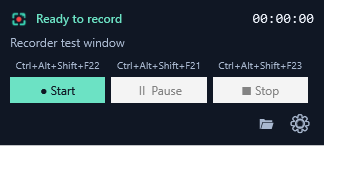
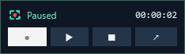

<p align="center">
  
</p>

# Personal Recorder

**A free, open-source Windows app for recording an application window without capturing your entire desktop.**

Record games, demos, and everyday apps to MP4 with a compact toolbar, configurable global shortcuts, and a floating mini panel. Built with C#, WPF, .NET 8, and [ScreenRecorderLib](https://github.com/sskodje/ScreenRecorderLib).

Licensed under the **MIT License**: free to use, modify, and redistribute, including commercially. No account, subscription, or cloud upload is required.



## Features

- **Application-window capture:** choose the window you want to record.
- **Full display-resolution output:** use the physical pixel dimensions of a connected display, independent of Windows UI scaling. Aspect ratio is preserved with padding where needed.
- **MP4 video:** H.264 encoding, 30/60 FPS targets, and hardware or software encoding.
- **Audio options:** default-device system audio, optional microphone, and optional mouse cursor capture.
- **Global shortcuts:** configurable Start, Pause/Resume, and Stop keys, including standalone function keys.
- **Compact controls:** recording status, elapsed time, shortcut labels, and Folder/Settings icons.
- **Floating mini panel:** minimizing leaves a draggable panel above the taskbar with recording controls. A tray menu provides another restore/exit route.
- **Remembered preferences:** save folder, display, application, audio, encoder, and shortcut settings persist locally.
- **Window reconnection:** reconnects to a recreated or restarted application window when there is an unambiguous match.
- **Safer saving:** unique filenames, low-space checks on local drives, and normal exit waits for recording finalization.
- **Failure recovery:** readable diagnostics, reporting of finalized partial recordings, and a software/30 FPS retry that creates a new file.



> Early release: short capture and regression tests pass, but long gaming sessions and every GPU/game combination are not yet validated. See the limitations below.

## Requirements

- Windows 10 version 1903 or newer; Windows 11 recommended.
- An **x64** Windows installation.
- [.NET 8 Desktop Runtime x64](https://dotnet.microsoft.com/en-us/download/dotnet/8.0) for framework-dependent builds.
- [Microsoft Visual C++ Redistributable x64](https://aka.ms/vs/17/release/vc_redist.x64.exe).
- Windows N editions need the Media Feature Pack.

Self-contained builds include the .NET runtime but still require the native Visual C++ and Windows media components.

## Build and run

Install the [.NET 8 SDK](https://dotnet.microsoft.com/en-us/download/dotnet/8.0), then:

```powershell
git clone https://github.com/JustUsKriogen/PersonalRecorder.git
cd PersonalRecorder
dotnet build PersonalRecorder.sln -c Release -p:Platform=x64
dotnet publish src/PersonalRecorder/PersonalRecorder.csproj -c Release -p:Platform=x64 --self-contained false -o artifacts/PersonalRecorder
.\artifacts\PersonalRecorder\PersonalRecorder.exe
```

Alternatively, run `./build.ps1` to publish the app. Keep the executable and its accompanying files together.

To package the .NET runtime with the application:

```powershell
dotnet publish src/PersonalRecorder/PersonalRecorder.csproj -c Release -p:Platform=x64 --self-contained true -o artifacts/PersonalRecorder
```

The project targets x64 because its recording engine includes native C++/CLI code.

## First recording

1. Open your application or game.
2. In Personal Recorder, open **Settings**, refresh the window list, and select the target.
3. Choose the display resolution, recording folder, target FPS, and audio options.
4. To change a shortcut, click its field and press the keys you want. Choose **Save settings**.
5. Press **Start**, pause/resume when needed, and press **Stop** to save.
6. Use the folder icon to open the recordings directory.

| Action | Default shortcut | Scope |
| --- | --- | --- |
| Start recording | Ctrl+Shift+F9 | Global |
| Pause / resume | Ctrl+Shift+F11 | Global |
| Stop and save | Ctrl+Shift+F10 | Global |
| Open recording folder | Ctrl+O | Toolbar focused |
| Open Settings | Ctrl+, | Toolbar focused |

Recording shortcuts must be distinct. Ctrl+O and Ctrl+, are reserved for toolbar navigation. Global shortcuts are suspended while Settings is open, and settings cannot be changed during recording. Closing Settings without saving discards edits.

Minimize to show the mini panel. Drag its header to reposition it, or use its arrow/double-click its header to restore the toolbar. Closing the main window exits; tray Exit saves any active recording before closing.

## Files and privacy

Recordings stay in the folder you choose. Filenames include the application's process name, local start date/time, and a unique suffix:

```text
MyGame_2026-11-10_19-30-00_a1b2c3.mp4
```

Preferences are stored in `%LOCALAPPDATA%\PersonalRecorder\settings.json`. Each recording can have adjacent `.mp4.log` and `.mp4.diagnostics.txt` files containing capture configuration, errors, and local paths. Review these before sharing a bug report.

The application does not upload recordings or require a network service. **System audio captures all applications on the default playback device**, not only the selected window. Microphone capture is off by default.

## Resolution, games, and limitations

- Output resolution is taken from the selected display at recording start. Smaller source windows are upscaled; this cannot create missing detail. Maximize the application or use borderless mode at the desired resolution for best results.
- Launcher and match windows are separate targets. For League of Legends or TFT, select the match window after it opens. Automatic launcher-to-match switching is not implemented.
- Closing the target stops and saves recording. A later Start can reconnect to the same application if there is a clear match; ambiguous matches require manual selection. Deleting an old video does not affect capture selection.
- Keep the **target application** restored: minimized applications may stop rendering. You can minimize Personal Recorder itself and keep recording.
- Exclusive fullscreen, protected content, elevated windows, and anti-cheat restrictions may affect capture. Borderless/windowed mode is recommended.
- Frame rate is a target, not a guarantee. Performance depends on the source application, CPU/GPU, encoder, and storage. This release targets SDR; HDR, 4K, audio-device changes, and long sessions need further validation.
- Local recording drives are checked for less than 512 MB free space. Network shares do not have that check.
- Recordings use fragmented MP4 for better partial-file recoverability. Some editors may require remuxing, and crashes or storage failures can still produce incomplete files.
- A hardware-encoder failure (`0xc00d36b5`) has been observed during a longer game session. Its underlying cause remains unconfirmed. **Retry: software · 30 FPS** retains resolution and creates a separate file; it uses more CPU and cannot recover missed footage.

When an encoder error occurs, **partial saved** means the engine reported successful finalization, not that playback has been independently verified. Preserve incomplete recordings if you plan to attempt recovery.

## Development and tests

```powershell
dotnet run --project tests/HotkeyTests/HotkeyTests.csproj -c Release
.\artifacts\PersonalRecorder\PersonalRecorder.exe --smoke-test --restart-test --recovery-test
```

Run UI/capture tests on an unlocked Windows desktop. The smoke test captures only the recorder's own window with audio disabled and writes into `smoke-results` beside the executable. It does not save test preferences. It temporarily registers Ctrl+Alt+Shift+F21–F24, so close other recorder instances first.

- Regression checks cover shortcut validation, conflicts, registration rollback, and application-window matching.
- Smoke checks cover settings save/cancel, pause/resume, mini-panel/tray lifecycle, and recording finalization.
- `--restart-test` deletes only its own generated test MP4, verifies clear preflight errors, then records again.
- `--recovery-test` simulates an encoder-failure callback and verifies that software retry preserves the previous file. It does not reproduce an actual GPU failure.
- `--software` selects software encoding for the smoke run.

## Contributing

Bug reports and pull requests are welcome. Include your Windows version, GPU, application being captured, output resolution, FPS, and encoder mode. Provide a minimal reproduction and relevant diagnostic excerpts after removing private paths or information. Please do not upload personal recordings without reviewing their contents.

Useful future additions include app-only audio, device selection, replay buffers, launcher-to-game switching, segmented recordings, and a live capture-health preview.

## License and acknowledgements

Personal Recorder is available under the [MIT License](LICENSE).

Recording is powered by [ScreenRecorderLib](https://github.com/sskodje/ScreenRecorderLib), also MIT-licensed. Its notice is included in [THIRD-PARTY-NOTICES.txt](THIRD-PARTY-NOTICES.txt). The logo artwork was generated for this project and is included with the application assets.

This project is independent and is not affiliated with Riot Games, Microsoft, or the developers of applications it can record.
